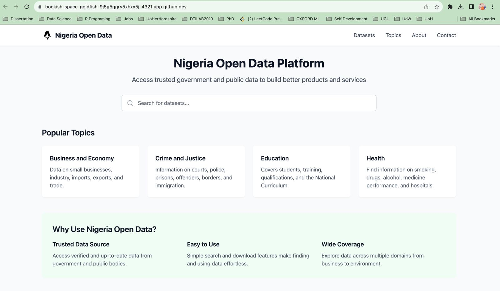
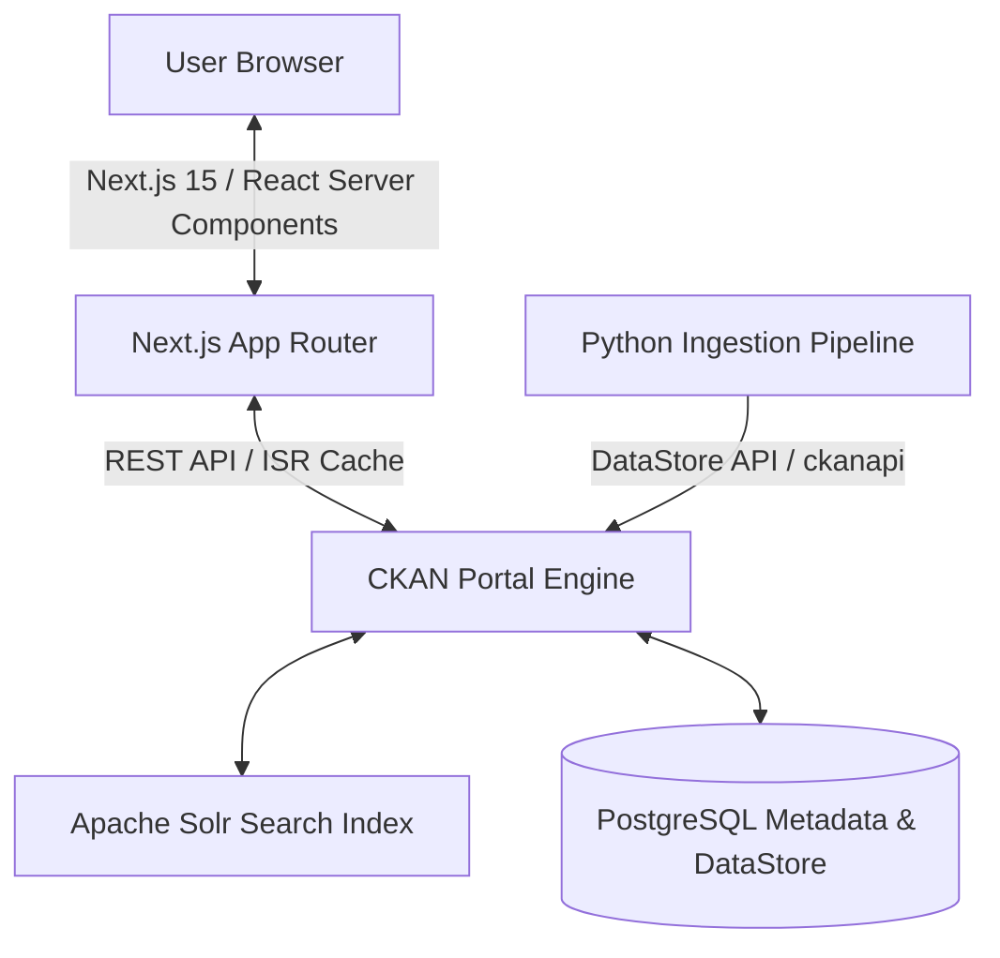

# **Nigeria-Open-Data**

Nigeria-Open-Data publishes and sources updated and historical data from newspapers, websites, and other sources, providing government, local authorities, and public data to help you build products and services.

The platform enables users to search for and access a wide range of publicly available datasets across various topics. From business and economy to transport and society, the data aims to empower individuals, organizations, and developers with the resources they need for informed decision-making and innovation.

----



---

## **Features**
- **Search Functionality**: Quickly locate datasets through a powerful search engine.
- **Wide Range of Topics**: Explore data across multiple domains such as crime, environment, health, and transport.
- **Comprehensive Dataset Library**: Access trusted and up-to-date data from government and public bodies.
- **Data for Everyone**: Whether you’re a developer, researcher, policymaker, or curious citizen, find the data you need.

---

## **Built With**
- **Frontend & App Router**: [Next.js 15](https://nextjs.org/) (TypeScript, React 19)
- **Data Processing & Pipelines**: [Python 3](https://www.python.org/) (Pandas, ckanapi client)
- **Styling**: [Tailwind CSS](https://tailwindcss.com/)
- **Infrastructure & Containerization**: Docker, Docker Compose, PostgreSQL (DataStore database), Apache Solr, Redis.

---

## **Data Topics**
- **Business and Economy**  
  Data on small businesses, industry, imports, exports, and trade.

- **Crime and Justice**  
  Information on courts, police, prisons, offenders, borders, and immigration.

- **Defence**  
  Includes data on armed forces, health and safety, and search and rescue operations.

- **Education**  
  Covers students, training, qualifications, and the National Curriculum.

- **Environment**  
  Explore data on weather, flooding, rivers, air quality, geology, and agriculture.

- **Government**  
  Data on staff numbers, pay, local councillors, and department business plans.

- **Government Spending**  
  Includes all payments by government departments.

- **Health**  
  Find information on smoking, drugs, alcohol, medicine performance, and hospitals.

- **Mapping**  
  Access data on addresses, boundaries, land ownership, aerial photographs, seabed, and land terrain.

- **Society**  
  Data related to employment, benefits, household finances, poverty, and population.

- **Towns and Cities**  
  Includes data on housing, urban planning, leisure, waste, and energy consumption.

- **Transport**  
  Covers airports, roads, freight, electric vehicles, parking, buses, and footpaths.

- **Digital Service Performance**  
  Track cost, usage, completion rate, digital take-up, and satisfaction metrics.

- **Government Reference Data**  
  Trusted datasets referenced and shared across government departments.

---

## **Getting Started**

### **Search for Data**
1. Use the **search bar** to find datasets relevant to your needs.
2. Filter datasets by topics or categories for more specific results.

### **Use the Data**
- Download datasets in accessible formats such as **CSV**, **Excel**, or **JSON**.
- Utilize datasets to create innovative products, conduct research, or support policy development.

---

## **System Architecture**



---

## **Installation & Local Setup**

### **1. Configure Environment**
Create a `.env` file in the root directory:
```env
CKAN_URL=http://localhost:5000
NEXT_PUBLIC_CKAN_URL=http://localhost:5000
CKAN_API_KEY=your_ckan_admin_api_token
CKAN_ORG_ID=nigeriaopendata
```

### **2. Run Infrastructure (Docker)**
Spin up the PostgreSQL databases, Solr indexer, and CKAN application:
```bash
docker-compose up -d
```

### **3. Import Data (Python Pipeline)**
Run the Python Common Data Model (CDM) ingestion script to populate datasets:
```bash
cd Data
pip install -r requirements.txt
python ingest.py
```

### **4. Launch Frontend App (Next.js)**
Run the development environment locally:
```bash
# Return to root directory
npm install
npm run dev
```
Open [http://localhost:3000](http://localhost:3000) to view the portal.

---

## **Contributing**

We welcome contributions to improve the platform!

1. **Fork** the repository.
2. **Make your changes** and submit a **pull request**.
3. Describe your updates clearly for review.

---

## **License**

This platform and its original source codes are open-sourced under the MIT License. Hosted data is subject to public domain usage agreements.

---

## **Contact**

For inquiries, feedback, or support:  
📧 **[support@Nigeriaopendata.gov.ng](mailto:hab31794@gmail.com)**
