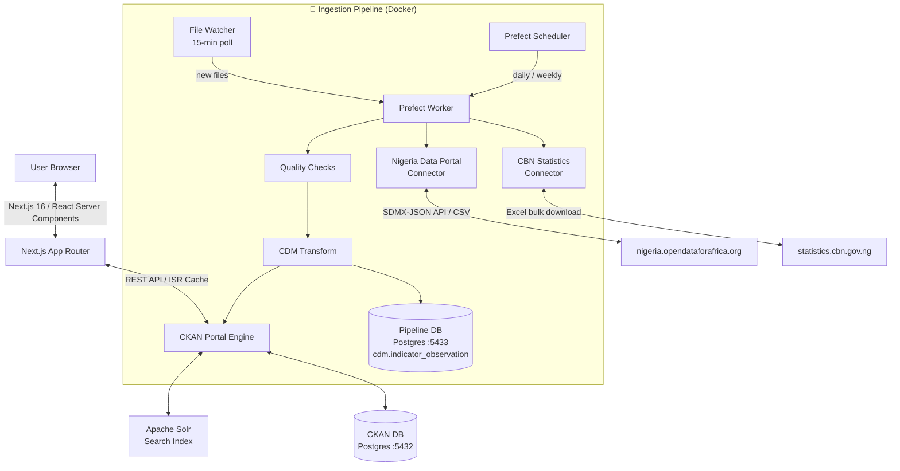

# Nigeria Open Data – Naija Open Data Platform

Nigeria-Open-Data is an open data platform that automatically ingests, processes, and publishes public data about Nigeria across health, economics, and agriculture domains.


---

## System Architecture



### Key design decisions

| Decision | Choice | Why |
|---|---|---|
| Orchestrator | **Prefect 3** | Fits into existing Docker stack with 2 extra services (vs Airflow's 4+). Pure Python. Self-hostable. |
| CDM database | **Dedicated Postgres** (port 5433) | Professional isolation — pipeline data never shares a schema with CKAN |
| Incremental strategy (APIs) | **Watermark table** (`cdm.ingest_manifest`) | Each run only fetches periods newer than the last successful load |
| Incremental strategy (files) | **SHA-256 hash comparison** | Download CBN Excel → if hash unchanged → skip. No re-processing |
| File-driven triggers | **15-min polling file watcher** | Drop a file in `data/raw/` → automatically ingested within 15 min |
| Scrapers | **Isolated in `pipeline/scrapers/`** | Clearly separated from connectors; used only when no API or download exists |

---

## Folder Structure

```
Nigeria-Open-Data/
├── Data/                            # Legacy ingestion (kept, backward compatible)
│   ├── ingest.py                    # Original CSV → CKAN pipeline
│   ├── scrape.py                    # Original Budget Office scraper
│   └── requirements.txt
│
├── pipeline/                        # Production pipeline
│   ├── config.py                    # ← Add new sources/indicators here
│   ├── deploy.py                    # Registers Prefect schedules
│   ├── requirements.txt
│   ├── Dockerfile
│   │
│   ├── connectors/                  # One file per data source
│   │   ├── base.py                  # BaseConnector (HTTP retries, file hashing)
│   │   ├── nigeria_data_portal.py   # SDMX-JSON API + CSV fallback
│   │   └── cbn.py                   # Excel bulk download + hash detection
│   │
│   ├── transforms/                  # Raw → CDM mapping
│   │   ├── cdm.py                   # CDMRecord dataclass (the schema)
│   │   ├── nigeria_data_portal_transform.py
│   │   └── cbn_transform.py
│   │
│   ├── quality/
│   │   └── checks.py               # Schema, range, null, duplicate checks
│   │
│   ├── db/
│   │   ├── schema.sql              # CDM DDL (run once on startup)
│   │   └── warehouse.py           # SQLAlchemy DB helpers
│   │
│   ├── scrapers/                  # Last-resort only (clearly isolated)
│   │   └── budget_office.py
│   │
│   └── flows/                     # Prefect orchestration entry points
│       ├── nigeria_data_portal_flow.py   # Daily @ 02:00 UTC
│       ├── cbn_flow.py                   # Weekly, Mon @ 03:00 UTC
│       └── file_watcher_flow.py          # Every 15 minutes (event-driven)
│
├── data/
│   └── raw/                       # Landing zone (file watcher monitors this)
│       ├── nigeria_data_portal/
│       ├── cbn/
│       └── budget_office/
│
├── src/                           # Next.js frontend (unchanged)
├── docker-compose.yml             # All 7 services
├── .env                           # Environment configuration
└── .github/workflows/ingest.yml  # CI/CD (daily + on push)
```

---

## Common Data Model (CDM)

Every indicator from every source is normalised into a single table:

```sql
-- cdm.indicator_observation (one row = one data point)
source_system   TEXT    -- 'CBN' | 'NigeriaDataPortal'
domain          TEXT    -- 'health' | 'economics' | 'agric'
indicator_id    TEXT    -- 'GDP_REAL' | 'CBN_INTEREST_MPR'
indicator_name  TEXT    -- human-readable name
geo_level       TEXT    -- 'national' | 'state' | 'lga'
geo_code        TEXT    -- 'NG' | 'NG-LA'
geo_name        TEXT    -- 'Nigeria' | 'Lagos'
period_type     TEXT    -- 'year' | 'quarter' | 'month'
period          TEXT    -- '2024' | '2024Q1' | '2024-01'
value           NUMERIC
unit            TEXT    -- '%' | 'Naira' | 'USD'
last_updated_at TIMESTAMPTZ
```

Unique constraint on `(source_system, indicator_id, geo_code, period)` — re-running a flow never creates duplicates.

---

## Getting Started

### 1. Configure environment

```bash
cp .env.example .env
# Edit .env and set your CKAN_API_KEY
```

If you change the pipeline database credentials, update both `PIPELINE_DB_URL`
(local development: `localhost:5433`) and `PIPELINE_CONTAINER_DB_URL`
(Docker: `pipeline_db:5432`). URL-encode special characters in URL passwords.
Existing PostgreSQL volumes keep their original credentials; changing environment
variables does not reset a database password.

### 2. Run everything with Docker

```bash
# Start all services (CKAN + pipeline + databases)
docker compose up -d --build

# Follow logs to watch the pipeline run
docker compose logs -f pipeline mage prefect-server
```

Mage is built from a clean Python base with `mage-ai==0.9.79`, replacing the
locally damaged prebuilt image. The first build downloads
Python dependencies. CKAN's DataStore database and read-only role are initialized
automatically, including on existing volumes. Prefect runs the scheduled Python
ingestion flows; Mage is available separately at http://localhost:6789.

If Docker reports `invalid ELF header`, `Input/output error`, or `ENOSPC`, check
host disk space with `df -h .` before rebuilding. Keep enough free space for image
downloads and intermediate build layers; a full host disk can corrupt Docker files.

Services started:
| Service | URL | Purpose |
|---|---|---|
| CKAN portal | http://localhost:5000 | Open data catalog |
| Next.js frontend | http://localhost:3000 | Data discovery UI |
| Prefect UI | http://localhost:4200 | Flow monitoring |
| Pipeline DB | localhost:5433 | CDM + manifest |

### 3. Trigger a manual run

```bash
# Manual backfill from 2020
docker-compose exec pipeline-worker \
  python -c "
  from pipeline.flows.nigeria_data_portal_flow import nigeria_data_portal_flow
  nigeria_data_portal_flow(start_period='2020')
  "

# Or via GitHub Actions: go to Actions → Run workflow → enter start_period
```

### 4. Drop a file for immediate ingestion

```bash
# Place any new CBN Excel file in the landing zone
cp my_new_cbn_data.xlsx data/raw/cbn/

# The file watcher will detect it within 15 minutes and trigger ingestion
```

### 5. Run without Docker (local development)

```bash
cd Nigeria-Open-Data
pip install -r pipeline/requirements.txt

# Apply schema (you need a local Postgres running on 5433)
python -c "from pipeline.db.warehouse import run_schema_migrations; run_schema_migrations()"

# Run one flow directly
python -m pipeline.flows.nigeria_data_portal_flow
```

---

## How to Add a New Data Source

Adding a new source takes 3 steps:

### Step 1: Add to `pipeline/config.py`

```python
SOURCE_REGISTRY = [
    # ... existing sources ...
    {
        "source_id": "WorldBank",
        "connector": "pipeline.connectors.worldbank.WorldBankConnector",
        "transform": "pipeline.transforms.worldbank_transform.transform",
        "domain": "economics",
        "schedule": "0 4 * * *",       # daily at 04:00 UTC
        "landing_dir": "worldbank",
        "indicators": [
            {
                "id": "WB_GDP_GROWTH",
                "name": "GDP Growth Rate",
                "dataset_id": "NY.GDP.MKTP.KD.ZG",
                "domain": "economics",
                "unit": "%",
            }
        ],
    }
]
```

### Step 2: Create `pipeline/connectors/worldbank.py`

```python
from pipeline.connectors.base import BaseConnector
import pandas as pd

class WorldBankConnector(BaseConnector):
    source_id = "WorldBank"
    landing_dir = "worldbank"

    def discover(self):
        # Return list of available indicators
        ...

    def fetch(self, dataset_config, since=None):
        # Download data (API or file), return DataFrame
        ...
```

### Step 3: Create `pipeline/transforms/worldbank_transform.py`

```python
from pipeline.transforms.cdm import CDMRecord, infer_period_type

def transform(df, dataset_config) -> list[CDMRecord]:
    # Map raw columns → CDMRecord fields
    ...
```

That's it. The existing flows and file watcher will automatically pick up the new source.

### Step 4 (optional): Add a new Prefect flow

If you want a custom schedule, copy `pipeline/flows/cbn_flow.py`, update `SOURCE_ID`, and add it to `pipeline/deploy.py`.

---

## How Scheduling Works

| Flow | When | Why |
|---|---|---|
| `nigeria_data_portal_flow` | Daily, 02:00 UTC | API is fast; check daily for new periods |
| `cbn_flow` | Weekly, Monday 03:00 UTC | CBN publishes monthly reports; daily is wasteful |
| `file_watcher_flow` | Every 15 minutes | Detect manually dropped files quickly |

**Manual backfill**: Trigger via Prefect UI → "Custom Run" → pass `start_period` parameter.  
**CI backfill**: GitHub Actions → Run workflow → enter `start_period` input.

---

## Debugging Failures

### Check Prefect UI

Open http://localhost:4200 → Flows → click a failed run → see per-task logs.

### Check the pipeline run log table

```sql
-- Connect to pipeline DB (port 5433)
SELECT * FROM cdm.pipeline_run_log
ORDER BY started_at DESC LIMIT 20;
```

### Check the manifest (watermarks)

```sql
SELECT * FROM cdm.ingest_manifest;
-- If status='failed', the watermark was NOT advanced — safe to re-run
```

### Re-run a specific indicator only

```python
from pipeline.flows.nigeria_data_portal_flow import (
    fetch_api_data, validate_and_clean, load_to_stage, transform_to_cdm, upsert_to_cdm
)
config = {"id": "GDP_REAL", "name": "Real GDP", "dataset_id": "NG_GDP_REAL", "domain": "economics"}
df = fetch_api_data.fn(config, start_period="2020")
clean = validate_and_clean.fn(df, config)
records = transform_to_cdm.fn(clean, config)
upsert_to_cdm.fn(records)
```

### Docker logs

```bash
docker-compose logs pipeline-worker --tail=100 -f
docker-compose logs pipeline-init
```

---

## Built With

- **Frontend**: Next.js 16 (TypeScript, React 19, Tailwind CSS)
- **Data Catalog**: CKAN 2.10 + Apache Solr + Redis
- **Ingestion Pipeline**: Python 3.11 (Pandas, SQLAlchemy, Requests, Tenacity)
- **Orchestration**: Prefect 3
- **Databases**: PostgreSQL 15 × 2 (CKAN DB + Pipeline CDM DB)
- **Infrastructure**: Docker, Docker Compose
- **CI/CD**: GitHub Actions (daily + on push)

---

## Contributing

1. Fork the repository
2. Create a feature branch
3. For new data sources, follow the 3-step guide above
4. Submit a pull request with a description of the source and indicators added

---

## License

MIT License. Hosted data is subject to the original source's terms of use.

---

## Contact

📧 [support@nigeriaopendata.gov.ng](mailto:hab31794@gmail.com)
