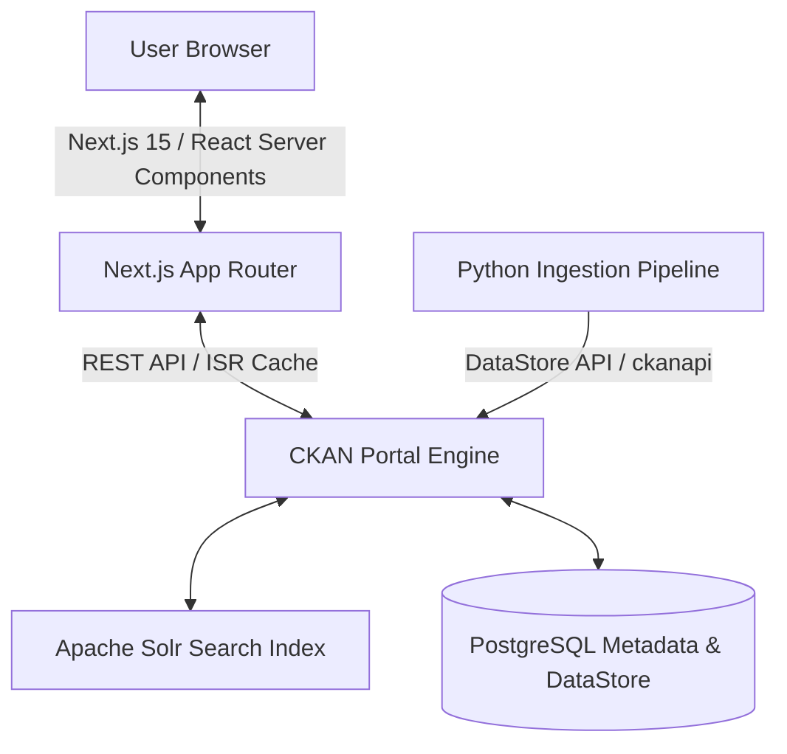

# Nigeria Open Data Platform

An enterprise-grade, high-performance, and scalable Open Data Portal designed to serve verified government, demographic, and economic public datasets. Built with a robust hybrid architecture connecting a modern **Next.js 15 App Router** frontend to a distributed **CKAN** metadata catalogue and PostgreSQL DataStore.

---

## System Architecture



- **Frontend Core**: React 19, Next.js 15, TypeScript, Tailwind CSS, Lucide Icons.
- **Backend / Catalog Engine**: CKAN API Core, powered by Docker-orchestrated Solr and PostgreSQL.
- **Data Ingest & Ingestion Pipeline**: Python 3, Pandas, and `ckanapi` implementing a strict Common Data Model (CDM) structure.

---

## Features

- **Dynamic Search & Filtering**: Client-side interactive dataset searching with full-text indexing, combined with multi-category filters (Topics, File Formats, and Publishers).
- **Topic-Based Organization**: Real-time group categorization (e.g., Business, Crime & Justice, Health, Education, Environment, Population) pulled dynamically from the CKAN API with dataset counter badges.
- **Common Data Model Ingestion**: Automated Python script (`Data/ingest.py`) that sanitizes, standardizes, and uploads local files into CKAN's PostgreSQL database.
- **File Downloads**: Single-click downloads that seamlessly request data files directly from the CKAN storage system.

---

## Getting Started

### Prerequisites

Before running the application, make sure you have the following installed:
- **Node.js 18+** & **npm**
- **Docker** & **Docker Compose**
- **Python 3.10+** (for running the data ingestion pipeline)

---

### 🔧 Configuration

1. Create a `.env` file in the root directory (based on `.env.example` if available).
2. Set the CKAN variables:

```env
CKAN_URL=http://localhost:5000
NEXT_PUBLIC_CKAN_URL=http://localhost:5000
CKAN_API_KEY=your_ckan_admin_api_token
CKAN_ORG_ID=nigeriaopendata
```

---

### Running the System

#### 1. Spin up the CKAN infrastructure
Launch PostgreSQL, Solr, and the CKAN application server via Docker:
```bash
docker-compose up -d
```

#### 2. Run the Ingestion Pipeline
To ingest the default datasets from the `Data/` folder into the database:
1. Navigate to the `Data/` folder.
2. Install Python dependencies:
   ```bash
   pip install -r requirements.txt
   ```
3. Run the ingestion pipeline script:
   ```bash
   python ingest.py
   ```

#### 3. Start the Next.js Frontend
Start the local development server:
```bash
npm run dev
```

Open [http://localhost:3000](http://localhost:3000) in your browser to view the application.

---

## Development & Production Builds

### Run TypeScript & ESLint Checks
```bash
npm run lint
```

### Build for Production
To generate an optimized production bundle with full Incremental Static Regeneration (ISR):
```bash
npm run build
```

---

## Common Data Model (CDM) Standards

The ingestion pipeline (`Data/ingest.py`) enforces high-quality standardizations:
- Strips trailing whitespaces and transforms all CSV columns to `lowercase_with_underscores`.
- Fills missing values with standard default placeholders (`N/A`).
- Formats geographic and numerical fields into consistent text rows before uploading to the DataStore.
